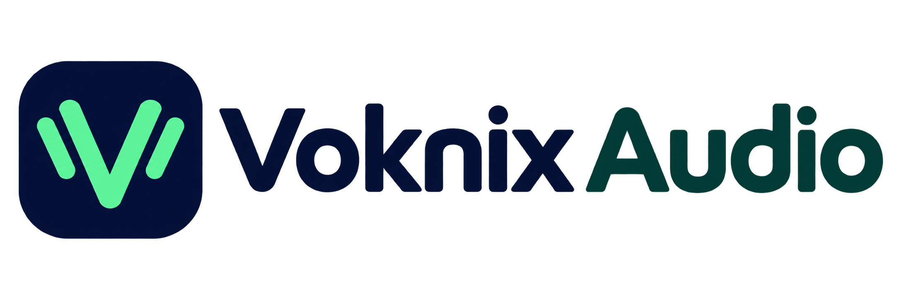
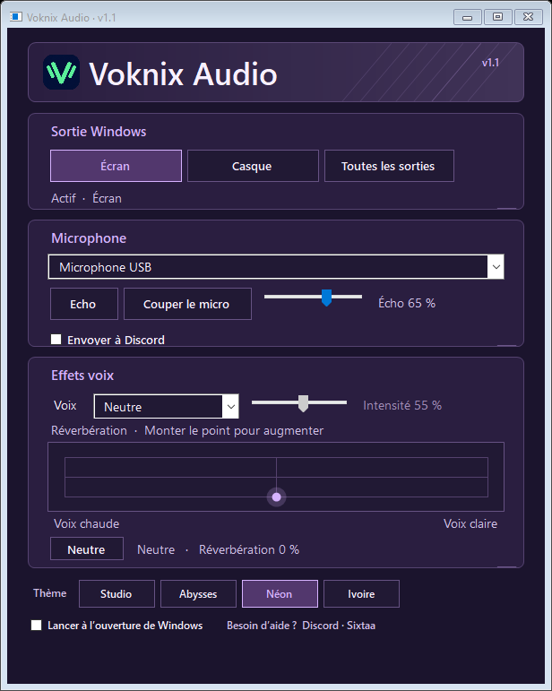

# Voknix Audio

J’ai créé Voknix Audio pour passer du casque aux haut-parleurs de l’écran en un clic. Tu peux aussi écouter ton micro dans le casque, tester des effets de voix et les utiliser sur Discord avec VB-CABLE.

## Dans l’appli

- **Casque et écran** — Choisis ton micro, renomme tes sorties audio et configure deux raccourcis pour passer de l’une à l’autre.
- **Effets de voix** — Essaie les modes Neutre, Voix grave, Voix aiguë, Robot et Radio. Tu peux régler l’intensité, le timbre et la réverbération.
- **Retour micro** — Active **Echo** pour t’écouter ou coupe ton micro depuis l’appli.
- **Préférences** — Choisis un thème parmi Studio, Abysses, Néon et Ivoire. Tes réglages restent sur ton PC et tu peux lancer l’appli au démarrage de Windows si tu veux.

## Ce que j’ai mesuré en appel

Sur un PC Windows à huit processeurs logiques, j’ai mesuré **20,7 Mio de RAM** et **0,13 % de CPU en moyenne** pour Voknix Audio v1.1. Le pic observé était de **0,73 %** sur environ une seconde.

Le test a duré 14,7 secondes en appel Discord le 19 novembre 2026. Les chiffres couvrent seulement Voknix Audio, hors Discord et VB-CABLE. L’effet actif lors du test reste inconnu. Les résultats peuvent varier selon ton PC et tes réglages.

## Installation et achat

Il te faut Windows 64 bits, un micro et une sortie audio pour t’écouter. Si tu veux envoyer ta voix modifiée sur Discord, installe **VB-CABLE** avec les droits administrateur, puis redémarre ton PC.

L’exécutable v1.1 est non signé. Windows peut afficher un avertissement SmartScreen au premier lancement. [Documentation Microsoft](https://learn.microsoft.com/windows/apps/package-and-deploy/smartscreen-reputation)

Le pack est à **4,99 €**, en paiement unique. Il contient Voknix Audio v1.1, le guide et l’installateur officiel de VB-CABLE. Pour l’acheter ou poser une question, contacte-moi sur **Discord** (Sixtaa).

[Guide d’installation et de dépannage](INSTALLATION.md) · [Comparatif](COMPARATIF.md) · [Notes v1.1](RELEASE-v1.1.md)
