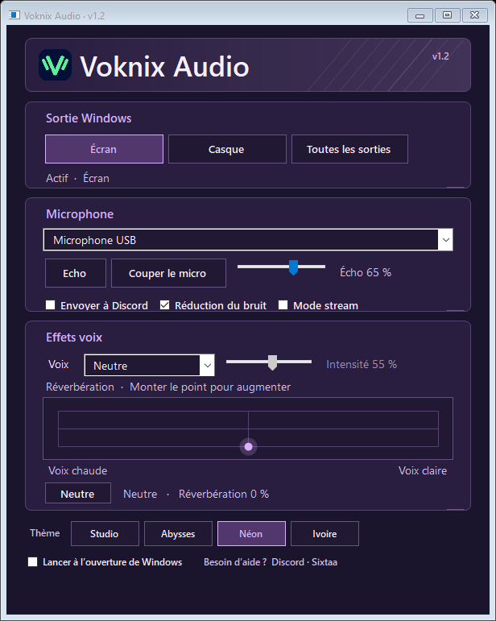

# Voknix Audio

**Change de sortie audio et ajuste ta voix depuis une seule fenêtre Windows.**

Passe du casque à l’écran en un clic, teste un effet au casque et envoie ta voix modifiée sur Discord. Voknix Audio v1.2 est conçu pour ces usages du quotidien.

## Ce que tu peux faire

- Choisir ton micro et détecter les sorties Windows disponibles. Donne un nom à tes sorties et attribue deux raccourcis, par exemple **Casque** et **Écran**.
- Choisir **Neutre**, **Voix grave**, **Voix aiguë**, **Robot** ou **Radio**. Dose le changement de hauteur avec **Intensité** et règle le timbre ou la réverbération dans le panneau **Effets voix**.
- T’écouter avec **Echo**, couper le micro sélectionné dans Windows ou envoyer ta voix modifiée à Discord via **VB-CABLE**.
- Choisir **Studio**, **Abysses**, **Néon** ou **Ivoire**. Le thème et les préférences de périphériques restent sur ton PC. Le lancement à l’ouverture de Windows est facultatif.

- **Réduction du bruit** intégrée et activée par défaut. Elle atténue surtout le bruit entre les phrases et le grondement grave.
- **Mode stream** pour couper le retour local Echo tout en gardant l’envoi vocal vers Discord.

## Consommation mesurée pendant un appel Discord

| Indicateur | Voknix Audio v1.1 |
| --- | ---: |
| RAM physique du processus | **20,7 Mio**, stable sur l’échantillon |
| CPU moyen | **0,13 %** du processeur total |
| Pic CPU observé | **0,73 %** sur un échantillon d’environ une seconde |

Mesure de la **v1.1**, réalisée sur un seul PC Windows à huit processeurs logiques, le 19 novembre 2026, pendant **14,7 secondes** en appel. Ces chiffres couvrent **le processus Voknix Audio seul**. La charge de Discord et celle du pilote VB-CABLE dans Windows sont exclues. Le mode d’effet actif n’a pas été consigné. Ces chiffres ne constituent pas une mesure de la v1.2. Les résultats peuvent varier selon le PC et les réglages.

## Prérequis et accès

- **Windows 64 bits**, un micro et une sortie audio pour écouter le retour.
- **VB-CABLE** pour transmettre la voix modifiée à Discord. L’installateur officiel est fourni dans le pack. L’installation du pilote demande les droits administrateur et un redémarrage.
- L’exécutable v1.2 est **non signé**. Windows peut afficher un avertissement SmartScreen au premier lancement. [Documentation Microsoft](https://learn.microsoft.com/windows/apps/package-and-deploy/smartscreen-reputation)

**Prix de lancement — 4,99 € en paiement unique, sans abonnement.** Le pack comprend Voknix Audio v1.2, le guide et le paquet officiel de VB-CABLE. Pour obtenir le logiciel ou poser une question, contacte **Sixtaa sur Discord** ou **sixtaa.17.sb@gmail.com**.

[Guide d’installation et de dépannage](INSTALLATION.md) · [Comparatif](COMPARATIF.md) · [Notes v1.2](RELEASE-v1.2.md)

